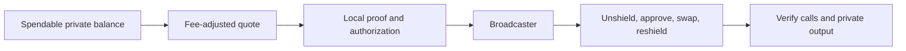

# Railgun integration assessment, checked 20 October 2026

Railgun can add shielded balances and private onchain swaps to Ophis. It does
not supply additional trading liquidity. The smallest useful integration is a
separate private-balance and single-transaction swap flow, initially using the
explicit 7702 APIs on Ethereum. Preserving Ophis's asynchronous CoW orderbook
requires a separate, recoverable multi-transaction flow; its eventual fill
cannot finish inside the funding transaction.
This document is the requested assessment. No Railgun UI, dependency install,
wallet creation, private proof or funded transaction was performed.

## Supported-chain intersection and current releases

The **published release**, not the older GitHub `main` branch, includes Base.
The [shared-models 8.2.1 network configuration](https://unpkg.com/@railgun-community/shared-models@8.2.1/dist/models/network-config.js)
defines Ethereum, Arbitrum, Polygon, BNB Chain and Base mainnets. All five
intersect Ophis's supported CoW-hosted chains. No current deployment was
established on Ophis-operated Optimism, Unichain, Robinhood or Arc. This also
means the new Robinhood Metric/Elfomo routes cannot directly use Railgun there.

| Network | Railgun privacy proxy | Block checked |
| --- | --- | ---: |
| Ethereum (1) | `0xfa7093cdd9ee6932b4eb2c9e1cde7ce00b1fa4b9` | 26,232,784 |
| Arbitrum (42161) | `0xFA7093CDD9EE6932B4eb2c9e1cde7CE00B1FA4b9` | 516,551,656 |
| Polygon (137) | `0x19b620929f97b7b990801496c3b361ca5def8c71` | 95,854,505 |
| BNBChain (56) | `0x590162bf4b50f6576a459b75309ee21d92178a10` | 128,719,126 |
| Base (8453) | `0x0047d1F97674614189E80566575FB615788AcF25` | 52,848,890 |

For every row I independently checked RPC chain ID, nonempty proxy, registry
and delegate bytecode, and the registry's `getContractAddress("RelayAdapt7702")`
against the published release. All five matched. Each proxy returned **25
basis points** for both `shieldFee()` and `unshieldFee()` at the recorded block.
These reads establish deployment/configuration correspondence, not a contract
audit, cross-chain bytecode equivalence or a successful private swap. Classic
shared adapts were not checked; the proposed first route explicitly uses
7702. Registry lookup calldata, actual/expected addresses and follow-up lookup
blocks are recorded separately from the initial code/fee snapshot. Records are in
`/Users/scep/ophis-addon-evidence/03-railgun/onchain-deployments.json`.

The npm `latest` versions checked were wallet **11.2.0**, shared-models
**8.2.1**, cookbook **3.0.2**, web/node broadcaster client **10.0.1** and engine
**9.9.1**. The wallet declares ethers **6.14.3**; Ophis's frontend uses ethers
**5.7.2**. Keep a future Railgun integration in an isolated, lazily loaded
module with its own compatible dependencies; avoid a frontend-wide ethers
upgrade. The broadcaster client's declared `~11.1.0` wallet peer range
**excludes 11.2.0**. A compatible peer declaration or a tested, narrowly scoped
resolution is needed before shipping; this is not a verified installable stack.
The [web client's published code](https://unpkg.com/@railgun-community/waku-broadcaster-client-web@10.0.1/dist/transact/broadcaster-transaction.js)
does contain 7702 authorization and Type-4 fee support; live broadcaster
acceptance remains untested. Engine 9.9.1 is within
the wallet's declared `^9.8.0` range, but no dependency installation was done.
Metadata and integrity-verified tarballs/selected code for shared-models,
wallet, engine, cookbook and the web broadcaster were saved without executing
package code. The node broadcaster was inspected through its metadata only.

## Recommended single-transaction private-swap flow

The broadcaster path can tolerate inner failures. Single-transaction packaging
does not guarantee rollback of every private-state change if a swap fails;
balances can remain publicly held by the ephemeral account until recovery.

The older [cross-contract guide](https://docs.railgun.org/developer-guide/wallet/transactions/cross-contract-calls)
describes a shared Relay Adapt that temporarily unshields, approves and swaps,
then reshields output. The [current 7702 guide](https://docs.railgun.org/wiki/learn/integrating-railgun/eip-7702-integration)
adds delegated ephemeral EOAs. Quote **taker and recipient must be the actual
executing account**: the shared adapt for the classic path or the user's
current ephemeral EOA for 7702. Sending output to Ophis Settlement or an old
adapt address would break the intended private flow.

Base is 7702-only. The published wallet's
[provider loader](https://unpkg.com/@railgun-community/wallet@11.2.0/dist/services/railgun/core/load-provider.js)
accepts that configuration. Its
[generic cross-contract entry points](https://unpkg.com/@railgun-community/wallet@11.2.0/dist/services/transactions/tx-cross-contract-calls.js)
automatically dispatch Base to 7702, while networks with both adapts retain
the classic path unless the explicit 7702 APIs are selected. Do not assume
that upgrading the dependency changes every network's execution path.

A concrete first route can use the Ethereum USDC/fxUSD Curve pool added in the
f(x) work. Its four-argument `exchange` returns output to its caller, making it
a suitable recipe candidate. The existing fork tests prove pool execution
from Settlement; they do **not** prove Railgun/7702 execution. Rebuild and
simulate the call for the adapt/ephemeral caller before exposing it.

The implementation should:

1. Load Wallet SDK, a browser-compatible encrypted database, persistent circuit
   storage and the prover only when private mode is opened. Initialize network
   providers, balance scans and the required PPOI services. The SDK's
   [engine setup](https://docs.railgun.org/developer-guide/wallet/getting-started/5.-start-the-railgun-privacy-engine)
   documents the persistent state; disabling scans is suitable only for a
   shield-only app, not private swaps.
2. Manage a dedicated user-controlled Railgun wallet locally. Do not request
   the seed of their existing MetaMask/hardware wallet or send mnemonic,
   encryption keys, notes or viewing keys to Ophis services. Ordinary injected
   EVM wallet connection does not expose Railgun signing capabilities. Derive
   the storage key with a vetted password KDF, keep it out of plaintext
   storage, require mnemonic backup before funding and support restore/rescan
   after storage loss. Put key-handling UI in a separate origin or tightly
   sandboxed context with a strict CSP and no third-party scripts; lazy
   loading alone provides no security isolation.
   [Railgun Connect is still described as in development](https://docs.railgun.org/wiki/learn/integrating-railgun),
   so it is not an available drop-in dependency for this implementation.
3. Build one narrow, validated recipe: exact ERC-20 approval, direct pool swap
   with positive minimum output, then shield every possible output/change
   token. Use integer token units and the SDK's fee/rounding calculations.
   Include sell-token dust, buy token and any intermediate tokens in the
   reshield list. Reconcile leftovers on the actual executing account: the
   ephemeral EOA for the proposed 7702 route, or the shared adapt for a classic
   route. The
   [Cookbook](https://github.com/Railgun-Community/cookbook) already supplies
   approval/recipe conventions.
4. For 7702, use `gasEstimateForUnprovenCrossContractCalls7702` and
   `generateCrossContractCallsProof7702`, then the compatible populate path
   and broadcaster submission. The
   [published API](https://unpkg.com/@railgun-community/wallet@11.2.0/dist/services/transactions/tx-cross-contract-calls-7702.d.ts)
   takes explicit unshield amounts, private recipients and calls. Keep the
   ephemeral address/index fixed across quote, proof and submission. Preserve
   Type-4 authorization and EIP-1559 gas fields, select a 7702-capable
   broadcaster and respect the recipe's gas floor. Check the registry against
   the pinned delegate and fail closed on mismatch. Also check the signed
   authorization's delegate and nonzero target chain ID; reject a chain-zero
   authorization. These checks apply to the execution signature and nonce as
   well as native account delegation.
5. Confirm the swap and resulting private balance before marking success.
   The [published 7702 implementation](https://unpkg.com/@railgun-community/wallet@11.2.0/dist/services/transactions/tx-cross-contract-calls-7702.js)
   deliberately submits `requireSuccess=false`; an outer successful receipt
   can contain a failed inner call and no reshielded output. Its extra gas
   probe can report an inconclusive/cannot-succeed result without throwing.
   Simulate and trace the exact signed batch with authorization applied and
   check every inner result. A separate strict probe using
   `requireSuccess=true` must rebuild matching proof, authorization and
   execution-signature data; do not flip a flag in an already signed batch.
   Confirm a delegated view call through the same authorization to detect an
   RPC silently ignoring it. Block submission on failure or an inconclusive
   result. Inspect receipt call errors and reconcile actual shield events/private balances.
   Provide recovery for stranded ephemeral balances and persist the used
   account index; an updated index must not make old balances inaccessible.

A tolerated failure can still consume gas, broadcaster fees and unshield
fees; a subsequent successful reshield also charges its fee. A failed reshield
can instead leave a public balance. Both need distinct error/recovery states.
The [published `EphemeralKeyManager` API](https://unpkg.com/@railgun-community/wallet@11.2.0/dist/services/railgun/wallets/ephemeral-key-manager.js)
provides index-addressable recovery: construct it with the loaded
`fullWalletForID(id)`, encryption key and optional mnemonic password, then call
its instance method `getAccount(chainId, index)`. The package-root export chain
includes this class, beyond the current-only helpers in `wallets.d.ts`. This
was verified in source, not by a wallet restore test.

The private route belongs beside the ordinary swap flow, not inside a GPv2
solver response. A future module can live under
`apps/frontend/apps/cowswap-frontend/src/modules/railgun/`, with its own wallet,
quote, proof, submission and recovery state. Existing
`modules/tradeQuote/hooks/useQuoteParams.ts`,
`modules/tradeFlow/hooks/useHandleSwap.ts` and
`modules/tradeFlow/services/swapFlow/index.ts` are the routing boundaries to
review. This is a proposed implementation map, not files already added.

## Retaining Ophis orderbook execution

This is a design inference from Railgun's one-transaction recipe and Ophis's
actual order/signing code:

- `contracts/src/contracts/libraries/GPv2Order.sol` defines `receiver` as a
  20-byte EVM address. A Railgun `0zk` address cannot go there.
- `packages/sdk/src/flow.ts` and the frontend swap flow sign and post an order,
  then wait for a later auction/settlement. They do not return purchased tokens
  during the original transaction. EIP-1271 support does not change this.
- Unshielding into the shared Relay Adapt and leaving funds there pending a
  future CoW fill would be unsafe; it is a public communal executor.

A possible second-stage integration uses a **user-controlled ephemeral EOA
per order**: unshield into it, approve the GPv2 VaultRelayer, sign/post a normal
CoW order with that EOA as owner/receiver, await settlement, then reshield from
that same account in a later transaction. A new escrow contract is not
inherently required for a client-controlled EOA prototype. An automated escrow
or EIP-1271 alternative needs its own design and review.

Before holding funds on a delegated EOA, verify that its canonical delegate
accepts only batches authenticated by that EOA's execution signature and
rejects wrong nonces, chains and replays. Pending balances depend on those
authorization checks; their contract-level security was not audited here.

The VaultRelayer approval can be part of the initial 7702 funding batch. The
later reshield needs its own gas/fee plan: reserve private fee tokens for a
broadcaster-supported shield-only batch and test that path before funding an
order. Public gas funding can introduce a link. CoW does not sponsor this
recovery. Also verify that the hosted orderbook and frontend accept a delegated
EOA using its EIP-712 signature rather than misclassifying it as EIP-1271.

That flow must retain the account/index and pending order through reloads,
handle cancellation, expiry, partial fills, reorgs and failed reshielding, and
allow recovery of both bought tokens and unsold input. It publicly exposes
that order's tokens, amounts and ephemeral account. It is a multi-transaction
workflow with correlation risks, not an atomic confidential CoW order. Do not
reuse a single public address across orders or weaken the SDK's receiver
checks to accept a `0zk` string.

## Fees, latency and privacy boundaries

Read current fees rather than hardcoding the observed 25 bps. Display initial
shielding separately from each swap's unshield and output-reshield fees, DEX
slippage/fees, gas and broadcaster premium. Gas premiums are quoted separately;
“gasless” means paid from shielded tokens, not free execution.
[Protocol deductions](https://docs.railgun.org/wiki/learn/railgun-deductions)
and [broadcaster integration](https://docs.railgun.org/developer-guide/wallet/broadcasters)
describe these costs.

[PPOI](https://docs.railgun.org/wiki/assurance/private-proofs-of-innocence)
is separate from core contracts. Supporting wallets describe an initial
one-hour standby for new shields; the original-shielder return path remains
available. Read actual spendability and broadcaster policy instead of adding
a universal one-hour smart-contract timer. Distinguish syncing, standby,
proof generation, quote expiry and insufficient fee-token balance in the UI.
Base's current release entry has no `poi` settings; its actual wallet and
broadcaster spendability policy needs separate verification before enabling it.
Proofs and broadcaster quotes can expire while a user waits; re-quote and
re-prove when their bound parameters change.
[Private-transaction UX](https://docs.railgun.org/developer-guide/wallet/transactions/ux-private-transactions)
describes the estimate → fee → proof → populate → submit sequence.

An unshield plus reshield costs approximately 0.5% before DEX/CoW fees and gas
at the observed rates. For close-to-par stablecoin swaps this can dominate the
economic benefit; compare the final privately received amount with the public
route in the confirmation.

Onchain router calls, pool amounts and public entry/exit transactions remain
observable. Quote servers, RPC requests and analytics can also correlate
users. A broadcaster does not make ordinary HTTP quote/analytics traffic
private. In private mode avoid attaching the connected public wallet, rebate
enrollment, identity cookies or existing wallet-linked trade telemetry to the
quote/proof flow. Keep secrets and private balances out of logs/error reports.

## Validation needed before implementation can ship

Start with a small ERC-20 shield/unshield path, then one single-transaction Curve route.
Use Sepolia for wallet/proof basics and a local Ethereum mainnet fork for the
actual liquidity recipe. Test full proof/broadcaster execution with dedicated
test wallets only after the client path is implemented. Required cases include
fee rounding, stale quotes/proofs, real 7702 authorization simulation, wrong
recipient/delegate, failed inner swap with successful outer receipt, complete
dust reshielding, restore/index resync and recovery without reusing an account.
An asynchronous CoW prototype needs additional fill/cancel/recovery tests.

The assessment used official docs, the actual published SDK artifacts and
read-only chain queries. Public source was sufficient without reverse engineering.
Claude reviewed the design and Jev checked evidence claims. Raw sources,
package-integrity records and review results are in
`/Users/scep/ophis-addon-evidence/03-railgun/`. No private transaction, SDK browser
build, proof generation or broadcaster availability test was run.
